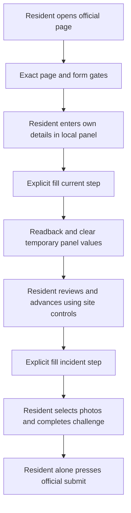

# Resident-browser helper design

Issue #6. Target: 2026-11-04. Status: proposal, no implementation in this change.

## Goal and boundary

A small userscript adds a local Hebrew fill panel to the official form already
opened in the resident's own browser. The resident provides their own details,
reviews the filled fields, chooses attachments, completes the ordinary human
challenge and presses the municipality's submit button themselves. The helper
never submits or claims that a report was accepted. No real case is tested.

Keep the Python fill-only adapter unchanged. Its isolated no-write session is a
separate tool, not the execution environment for this helper. Its live headless
Cloudflare failure is not bypassed: the resident opens the normal page directly.

## Delivery choice

Prefer a dependency-free userscript, not a bookmarklet. Userscript metadata can
scope execution and avoids teaching residents to paste JavaScript into a page.
A bookmarklet could be a later separately reviewed distribution, but is excluded
from the first implementation. No external loader, updater, analytics or CDN.

The repository publishes a reviewed static `.user.js` file, with readable source
and installation instructions. Installing a browser extension or accepting its
terms is the resident's choice, not performed by this project. Desktop browser
support depends on the resident's chosen userscript manager. Safari/mobile
installation is not claimed until tested; WebKit synthetic execution tests do
not prove extension compatibility. Manual form filling remains a fallback.

Metadata: exact official HTTPS match, `@grant none`, `@noframes`, no `@connect`,
no remote requirements or update URL. Runtime checks also reject non-top-level
frames, non-HTTPS, wrong host, nonstandard port, wrong `/moked/` pathname or
nonempty query. Fragment identifiers may be retained for normal site steps.

## User interface and data ownership

- Collapsible Hebrew RTL panel with semantic labels, keyboard focus, visible
  status text and a clear statement: local fill only, review before sending.
- Required checkbox: these are my own resident details, not another person's.
- Two explicit buttons: fill contact step, fill incident step. Neither presses
  the site's next button, captcha nor submit. The resident navigates site steps.
- Contact inputs match the existing ResidentReport's names, phone, ID and
  resident street/house. Incident inputs are street, house and description.
- Street choices are copied only from the relevant public dropdown options.
  Never infer residency, a street ID, contact identity or incident facts.
- Validate before mutation. No default identity, stored profile, imported file,
  clipboard read, hidden URL payload or remote message bridge.
- No upload helper in the first version. Resident selects photos using the
  municipality's native file controls. Browser file permissions stay intact.
- The panel is not a second form. No submit control; its buttons are type=button.
  Enter in panel fields cannot accidentally submit the surrounding city form.

All values remain only in page memory/visible municipal fields. No storage APIs,
logs, network calls, clipboard writes, downloads or background worker. After
successful readback, clear the panel's corresponding source values; the city's
filled fields necessarily remain for resident review. A Clear button removes
panel values and transient errors, not the city's values. A Remove helper button
removes the panel and handlers without altering municipal form data. Closing or
reloading the tab discards helper state. This does not protect against another
extension or the municipality's own scripts reading fields on its page.

## Gates and mutations

Before mounting and before each fill, require exactly one form46 with observed
method/action/enctype and the expected current-step controls. Check each target's
name, semantic key, type, uniqueness, enabled/editable state and visibility.
Reject nonblank target fields rather than silently overwriting user input.
Reject conflicting/preselected nonresident branch. Snapshot only target values,
never the whole form. No hidden control enumeration or serialization.

Contact fill selects the truthful resident radio, dispatches its ordinary change
event, waits with a bounded MutationObserver for the expected visible conditional
fields, then fills validated values and dispatches input/change as needed. It
never clicks next. Incident fill runs only after the resident manually advances.
Description limit is700 characters. Street IDs must be present in live options.
Numeric ID length is not identity authentication. The helper does not relax native

Issue #6. Target: 2026-11-04. Status: proposal, no implementation in this change.

## Goal and boundary

A small userscript adds a local Hebrew fill panel to the official form already
opened in the resident's own browser. The resident provides their own details,
reviews the filled fields, chooses attachments, completes the ordinary human
challenge and presses the municipality's submit button themselves. The helper
never submits or claims that a report was accepted. No real case is tested.

Keep the Python fill-only adapter unchanged. Its isolated no-write session is a
separate tool, not the execution environment for this helper. Its live headless
Cloudflare failure is not bypassed: the resident opens the normal page directly.

## Delivery choice

Prefer a dependency-free userscript, not a bookmarklet. Userscript metadata can
scope execution and avoids teaching residents to paste JavaScript into a page.
A mobile bookmarklet and a zero-install copy/paste fallback are additional
delivery paths, as described below. Each executable path needs separate tests. No external code loader, updater, analytics or CDN. A separately approved
private report-package service may supply data, never executable code.

The repository publishes a reviewed static `.user.js` file, with readable source
and installation instructions. Installing a browser extension or accepting its
terms is the resident's choice, not performed by this project. Desktop browser
support depends on the resident's chosen userscript manager. Safari/mobile
installation is not claimed until tested; WebKit synthetic execution tests do
not prove extension compatibility. Manual form filling remains a fallback.

Metadata: exact official HTTPS match, `@grant none`, `@noframes`, no remote requirements or update URL. For an explicitly approved report-package
service only, a narrow userscript-manager cross-origin request grant may be
needed. This is a separate reviewed mode, not a wildcard network permission. Runtime checks also reject non-top-level
frames, non-HTTPS, wrong host, nonstandard port, wrong `/moked/` pathname or
nonempty query. Fragment identifiers may be retained for normal site steps.

## User interface and data ownership

- Collapsible Hebrew RTL panel with semantic labels, keyboard focus, visible
  status text and a clear statement: local fill only, review before sending.
- Required checkbox: these are my own resident details, not another person's.
- Two explicit buttons: fill contact step, fill incident step. Neither presses
  the site's next button, captcha nor submit. The resident navigates site steps.
- Contact inputs match the existing ResidentReport's names, phone, ID and
  resident street/house. Incident inputs are street, house and description.
- Street choices are copied only from the relevant public dropdown options.
  Never infer residency, a street ID, contact identity or incident facts.
- Validate before mutation. No default identity, stored profile, imported file,
  clipboard read, hidden URL payload or remote message bridge.
- Resident selects photos through native file controls in the first version.
  Package mode may provide a local photo download, never silently populate a
  municipal file input. Browser file permissions stay intact.
- The panel is not a second form. No submit control; its buttons are type=button.
  Enter in panel fields cannot accidentally submit the surrounding city form.

All values remain only in page memory/visible municipal fields. No storage APIs,
logs, network calls, clipboard writes, downloads or background worker. After
successful readback, clear the panel's corresponding source values; the city's
filled fields necessarily remain for resident review. A Clear button removes
panel values and transient errors, not the city's values. A Remove helper button
removes the panel and handlers without altering municipal form data. Closing or
reloading the tab discards helper state. This does not protect against another
extension or the municipality's own scripts reading fields on its page.

## Gates and mutations

Before mounting and before each fill, require exactly one form46 with observed
method/action/enctype and the expected current-step controls. Check each target's
name, semantic key, type, uniqueness, enabled/editable state and visibility.
Reject nonblank target fields rather than silently overwriting user input.
Reject conflicting/preselected nonresident branch. Snapshot only target values,
never the whole form. No hidden control enumeration or serialization.

Contact fill selects the truthful resident radio, dispatches its ordinary change
event, waits with a bounded MutationObserver for the expected visible conditional
fields, then fills validated values and dispatches input/change as needed. It
never clicks next. Incident fill runs only after the resident manually advances.
Description limit is700 characters. Street IDs must be present in live options.
Numeric ID length is not identity authentication. The helper does not relax native
validation constraints, disable controls or change the official submit handler.

Read back only the helper's explicit target list and resident radio. On mismatch,
stop with a value-free stage code, tell the resident to review/refresh, and do not
retry or roll back in a way that could overwrite subsequent resident edits.
Schema drift stops before filling when detectable; mutation failure may leave
partial fields and must be disclosed. Never claim atomic filling.

Do not read, write, retain, poll or transmit hidden CSRF/session/captcha fields,
Turnstile API state, cookies or challenge frames. No token extraction even for
status. The local-only helper does not call fetch, XHR, WebSocket, sendBeacon, form.submit,
requestSubmit or click on municipal action buttons. Normal field events may
trigger the municipality's own script behavior, which was not fully inspected;
this is not a guarantee that the website itself sends no background requests.

## Verification and gates

Before implementation, agree this design; then use a separate issue/PR with
independent exact-head review. No billing changes or CI protection bypasses.

Offline synthetic fixtures only, exact official URL intercepted in tests:

- Chromium and WebKit current-step fill and readback with synthetic variables.
- Native next and submit remain available to a human; helper alone produces no
  submit event, report request, file attachment or captcha interaction.
- Sentinel hidden controls and challenge API getters throw on helper access.
  Verify no access and values untouched, without extracting tokens.
- Wrong host/frame/path/query, absent/duplicate/changed controls, nonresident,
  prefilled/disabled fields, invalid inputs, timeout and partial failure cases.
- Storage/network/clipboard APIs instrumented to fail if helper invokes them.
- Keyboard/Enter isolation, labels, RTL, focus, status messages and remove/clear.
- Synthetic screenshots reviewed at desktop and narrow/mobile viewport sizes.
- JavaScript unit/branch coverage floor80%, separate from Python's floor80%.
  Container tests execute both engines, layout/privacy scan and security checks.

Current standalone CI cannot start due account billing restriction (#3). Keep
implementation PRs pending until review and required checks can actually run.
No live municipal test or acceptance claim. First resident use needs a truthful
real incident and the resident's own deliberate manual submission; no agent
submission permission is created by this design.

## Open checks before implementation

- Confirm real visible step selectors and resident conditional events in a
  resident-controlled session without submitting or inspecting hidden tokens.
- Verify chosen userscript manager's isolation/match behavior and supported
  browsers; document any installation limits without promising Safari support.
- Choose a pinned JavaScript coverage/lint toolchain and expand layout manifest
  for userscripts/tests only when that implementation PR adds those paths.

## One-link prepared-report handoff (added requirement)

Intended resident flow: the resident sends their photo and incident details to
their assistant; the assistant prepares description, street and photo as one
private package; the resident opens one link; the installed-once helper fills
on the real official page; the resident completes Turnstile and submits.
This design covers the handoff contract, not permission to operate a new data
service or to share anyone's real report. No real package is created here.

### Preferred route and explicit stages

1. Assistant prepares a reviewed incident package for that same resident. Do not
   add someone else's contact identity. No municipality/session/captcha tokens.
2. A private package service issues a high-entropy single-use capability, with
   expiry no later than30minutes after creation and optional earlier revocation.
   Package is encrypted at rest. No capability or incident text in access logs.
3. Resident opens a link to the official exact form URL with a fragment carrying
   only the capability and protocol version, not names, IDs, phone, description,
   street or photo bytes. The helper promptly removes its fragment with
   history.replaceState before retrieval; it never modifies unrelated fragments.
4. The helper shows the package source and a resident consent button before a
   narrowly scoped cross-origin retrieval from the fixed approved service.
   No remote code, redirect-following or arbitrary URL in a package. Capability
   is consumed atomically on successful retrieval; expired, reused or revoked
   capabilities return only a safe error and manual-fill fallback. No refresh
   loops. Losing a consumed response requires a new package, not token reuse.
5. Validate strict versioned JSON schema and limits, preview incident text and
   matched street, then resident explicitly fills the current visible step.
   Contact identity is entered locally by the resident, outside the package.
   Site navigation, challenge and final submission remain entirely manual.
6. Clear capability/package buffers as soon as practical; no persistent helper
   cache. The service deletes ciphertext on consumption or expiry, with bounded
   deletion of backups documented before launch. The resident can revoke before
   use. Native field values remain visible for their own review.

This is one link to reach the actual form with a package, not a promise of one
click, zero confirmation or unattended submission. Installation is once, but
consent/review is per package. If the helper is absent or the page is blocked,
the link must not submit or transfer data to the municipality automatically.
A normal manual-fill path remains available without the package service.

### Payload limits and schema

Version1: random report reference, creation/expiry timestamps, fixed municipality
identifier, description (1-700 Unicode characters), street ID plus public street
label for mismatch detection, house number, optional photo metadata and digest.
No HTML, script, selector, destination URL, command, identity/contact fields,
CSRF, cookies or challenge tokens. Reject unknown properties and unsupported
versions. Treat every string as plain text, set via value/textContent only.
Incident JSON maximum16KiB; at most four JPG/PNG photos, each10MB and40MB total,
with validated MIME/signature, safe dimensions and stripped metadata. The
assistant retains originals only under the resident's own authorized policy;
package copies are privacy-minimized, not a reason to retain raw EXIF.

Do not embed raw report data or base64 photos in fragments: URLs leak through
browser history, sync, extensions, copied chats and screenshots, and large URLs
fail inconsistently. A capability fragment avoids ordinary HTTP Referer/server
path logging but is still a bearer secret readable by page scripts/extensions.
It must never contain identity details or be described as an authenticated
resident session. A municipal page script could read it before the helper;
removing it quickly reduces exposure but cannot guarantee secrecy.

If that bearer-link risk is unacceptable, use a private landing page requiring
resident authentication, then a per-request helper handoff approved by the
resident. That is safer for sensitive packages but adds a page/confirmation and
requires a reviewed cross-origin bridge. Do not implement an arbitrary
postMessage listener or claim the strict one-page flow has no privacy tradeoff.
Choosing the service/origin/auth model is a load-bearing open design decision,
not filled by a guessed domain or public paste service.

### Photo handoff

First implementation: helper offers a download of the package's sanitized photo
using a local Blob after explicit resident consent. Resident chooses the saved
file in the official file picker. This adds an attachment step but respects
browser restrictions and prevents an unexpected municipal upload. It must be
clear when text filled but photo has not been attached; no success claim based
on metadata alone. Revoke object URLs and clear buffers after use/removal.

Direct File/DataTransfer population is deferred: it may be possible in some
browsers but can trigger immediate municipal uploads or fail in Safari. It needs
separate review and synthetic upload-side-effect tests before offering it. No
fetch of a municipal upload endpoint. The private service must support deleting
photo bytes after retrieval/expiry without retaining URLs in logs.

### Additional threat model and tests

- Stolen/replayed/forwarded link: short expiry, atomic single use, revocation,
  no personal identity in payload, explicit preview, no auto-submit. A forwarded
  link is not proof of reporter identity; do not silently bind it to a resident.
- Malicious package: strict allowlist/schema/lengths, fixed service origin,
  no redirects or executable content, image decoding limits and plain-text DOM.
- Confused deputy: package cannot change municipality, host, form targets,
  contact identity, challenge or submission behavior. Current form gates apply.
- Third-party page/extension access: disclose the limitation. No claim that a
  fragment is invisible to the official page or that encryption-at-rest protects
  an opened browser. No analytics, localStorage, service worker or clipboard.
- Cross-origin service: scoped grant, authenticated response integrity, no CORS
  wildcard over credentials, no wildcard connect, no service secret in script.
  No privileged userscript manager API exposed through the page's JavaScript.
- Tests cover expiry boundary, concurrent/replay retrieval, revocation, oversized
  JSON/photos, malformed/unknown properties, wrong street label/ID, hostile
  strings, token-field probes, blocked service, interrupted fetch and missing
  photo, plus no municipal network side effects or submission by the helper.

Additional open work before implementation: decide and review the fixed private
service, resident authentication/capability risk, deletion/backups and permitted
photo handling. Keep the local manual-entry helper implementable independently.

## Delivery paths: desktop, mobile and zero-install fallback

1. **Desktop userscript:** preferred installed-once helper for a compatible
   browser/userscript manager. Same exact-page gates and explicit-fill behavior.
   The resident chooses and installs the manager; no extension is installed by
   the assistant. Supported manager/browser combinations must be verified before
   publishing installation claims.
2. **Mobile bookmarklet:** no extension installation, but the resident must save
   a JavaScript bookmark and invoke it from the official page. Mobile bookmark
   editing, browser JavaScript-URL rules and site CSP can make this awkward or
   fail. This is a candidate path, not currently verified on iOS/Safari or Android.
   Use a reviewed self-contained bounded script, no remote executable loader.
   A bookmarklet cannot bypass normal browser permissions/CORS or upload files
   automatically. Keep full code reviewable, document its exact version, and
   offer fallback when bookmarklets are blocked. Do not recommend pasting code
   into the address bar or console as an improvised alternative.
3. **Copy/paste fallback:** no helper or extension installation. The private
   report-package landing view gives the resident clearly separated prepared
   text/street/house and an explicit photo download. Resident opens the official
   form, enters their own contact details, pastes incident text, chooses the
   street and photo, completes the challenge and submits manually. Copy buttons
   run only after a resident gesture; selectable text also works when clipboard
   permission is denied. No claim that cross-origin fields auto-fill. This is
   the reliable zero-install baseline, subject to the official site's own access.

A website cannot silently inject code into another origin's municipal form.
Opening one link without a previously installed helper does not grant that
capability. A private prepared-report page can reduce copying work but cannot
promise automatic filling on an unmodified mobile browser. The bookmarklet also
requires one-time bookmark setup, even though it needs no extension.

Tests and docs must distinguish engine execution from actual deployment support:
WebKit E2E is not proof that an iOS userscript manager or bookmarklet installation
works. Record tested browser/version/manager combinations and manual steps,
keyboard/touch sizes, photo download/picker behavior, clipboard refusal and
blocked-bookmarklet fallback. Until device testing, label mobile automation
experimental and show the copy/paste route first. Do not add runtime telemetry
about the resident's device or reports to discover compatibility.
